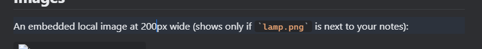

- I need to make some upgrades to the markdown editor tab
- To the section with bold, italic, etc., add more tools:
    - callouts
    - bullet points
    - numbered list
    - checklist
    - horizontal divider
    - heading
    - raw html
- For the formatted mode, I would like to polish up the way that data is viewed and edited.
    - I should no longer be able to create special renderable markdown elements by typing. This will be reserved for the raw mode only. Rather, the toolbar buttons I just suggested to add will add those. (Keyboard commands will exist for those tools)
    -  When the cursor is in a line in the formatted mode, the line should no longer become highlighted. Also, the text will not render as raw either. Bullet points will be bullet points, not dashes, for example. As another example, in a code block in format mode I should not be able to see the beginning or ending ```, since it is rendered as a component that can be edited. To delete it there will be an 'x' popup.
    - Links: Should have an edit icon button next to it when the cursor is in it such that the user clicks it and sees a small popup where they can edit the link behind the text.
    - Tables:
        - When the cursor is in the table, there will be a small popup toolbar to add and delete rows and columns, or an 'x' button to remove the whole table.
        - The user should be able to click and drag to select multiple cells within the table, just like a google docs table.
        - The hightlight background for a table cell should be the primary site color, not just blue.
    - Headings: When the cursor is in the heading, the user will see a popup menu where they select the size of the heading.
    - Images: Pictures should be able to be rendered in format mode, and dragged to be resized. If clicked, there will be a button to change the link and also an 'x' to remove it. When first adding the picture from the toolbar, it will make the user select an image from the filesystem.
    - Math blocks: Math blocks and strings will let the user type in the exact latex to format it correctly.
